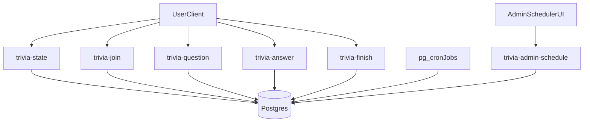

# MedTrivia Daily Live Implementation Plan

## Assumptions (defaulted)
- Canonical quiz start is `8:00 PM America/New_York` (DST-aware).
- Backend will be Supabase-first (Postgres + RLS + Edge Functions + pg_cron).
- Existing auth in [`core.js`](c:/Users/Hasan-PC/Desktop/MedHelp/core.js) is reused; trivia remains free for non-licensed users.

## Phase 1: Data Model + Scheduling Automation
- Add migration set under [`supabase/migrations`](c:/Users/Hasan-PC/Desktop/MedHelp/supabase/migrations) for:
  - `trivia_sets` (date-scoped daily batch metadata).
  - `trivia_questions` (10 questions per set, options, correct index, rationale, order).
  - `trivia_sessions` (per-user/guest run, start/end timestamps, score, duration, tz snapshot).
  - `trivia_answers` (question-level answer logs with server-side timing validation fields).
  - `trivia_daily_stats` (cached aggregates: participants, perfect scores, completion rate).
  - `trivia_waiting_room_presence` (lightweight live counter rows with TTL heartbeat).
- Add constraints:
  - exactly 10 questions per active day set.
  - one attempt per identity per day (configurable flag if retakes later desired).
  - immutable `question_order` once a set is published.
- Add SQL helper functions:
  - `get_current_trivia_state(now_tz)` returns `pre_hype`, `waiting_room`, `live`, `post_game`, `no_content`.
  - `get_today_set_for_play()` resolves date in `America/New_York`.
  - `record_trivia_answer(...)` enforces server-side 60s window and lock-in.
  - `finalize_trivia_session(...)` computes final score + share grid + rank snapshot.
- Add pg_cron jobs:
  - `19:30 ET` pre-open presence window.
  - `20:00 ET` mark set live and warm stats.
  - post-close aggregate refresh and fallback alert trigger if next day set missing.

## Phase 2: Backend APIs / Edge Functions
- Create Edge Functions:
  - `trivia-state` (state machine + countdown timestamps + previous day stats).
  - `trivia-join` (create/join session for authenticated user or guest username token).
  - `trivia-question` (serve current question deterministically for synchronized progression).
  - `trivia-answer` (authoritative timing + correctness + freeze on first answer).
  - `trivia-finish` (final stats, leaderboard slice, share payload).
  - `trivia-admin-schedule` (admin-only bulk upload/schedule questions).
- Add admin alert function (missing tomorrow content) via existing mail stack conventions from project APIs.

## Phase 3: Frontend Trivia Experience
- Add dedicated page `med-trivia.html` (+ optional route alias) following your supplied UI direction:
  - top live indicators, sticky timer bar, per-question 60s timer UI.
  - 5-second rationale window between questions.
  - end-of-game modal banner with score, percentile, and copy/share grid.
- Implement robust client state machine:
  - `pre_hype` (normal CTA + previous results + next start message).
  - `waiting_room` (30-minute synchronized countdown + live waiting count).
  - `live` (10-question loop, hard lock-in, no answer edits).
  - `closed/no_content` (graceful message + previous-day stats).
- Audio integration from provided files:
  - `audio/Clock.mp3`, `audio/correctAnswer.mp3`, `audio/wrongAnswer.mp3`, `audio/BellRing.mp3`.
  - global mute toggle + persisted preference.
- Enforce guest flow:
  - if not signed in, require temporary username before joining live session.
  - cache guest identity in local/session storage for trivia only.

## Phase 4: Auth UX + Admin + Site-wide Growth CTA
- Extend auth modal in [`core.js`](c:/Users/Hasan-PC/Desktop/MedHelp/core.js):
  - add optional `username` field for signup and persist to profile table.
- Add guest username capture UI in trivia waiting room (without granting paid access).
- Build admin page (private) for scheduling daily sets:
  - date picker, bulk paste/import, validation for exactly 10 questions, preview before publish.
- Add global MedTrivia CTA card injection in [`core.js`](c:/Users/Hasan-PC/Desktop/MedHelp/core.js) similar to existing global banner insertion, so every major page gets a pre-footer “Free Daily Clinical Challenge” module.

## Validation and Hardening
- Add integration test script for:
  - state transitions around 7:30/8:00 PM ET.
  - timer tampering (late answers rejected by server).
  - aggregate counts (`participants`, `perfect_10`).
  - guest + authenticated flows.
- Add anti-abuse controls:
  - one active session per identity/day.
  - answer idempotency keys.
  - basic rate limits on answer submissions.
- Add observability fields in session tables for dispute/debug (`client_latency_ms`, `server_received_at`, `question_started_at`).

## Data Flow Diagram
