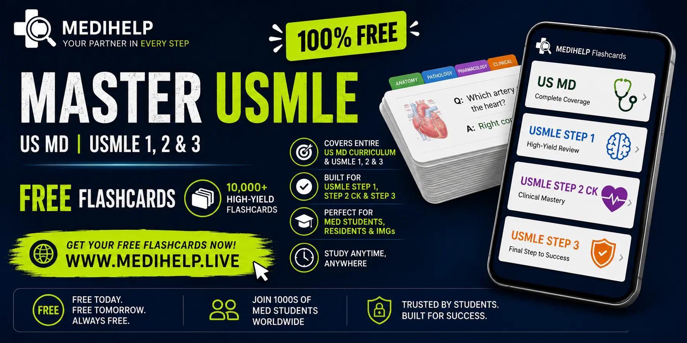
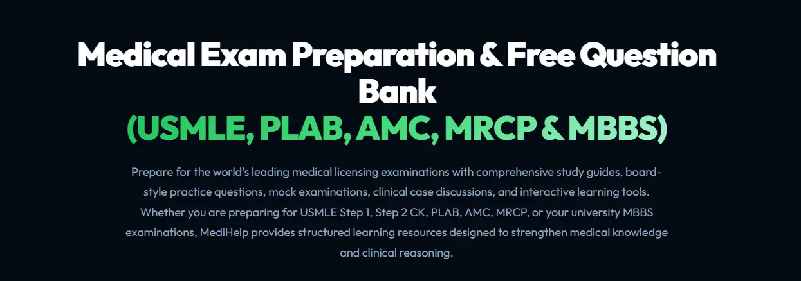
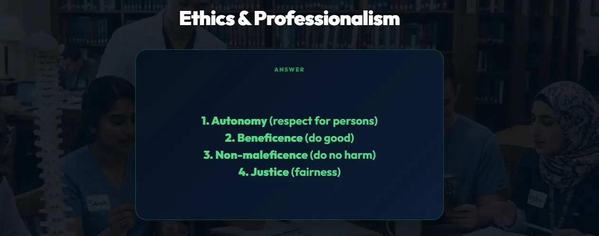
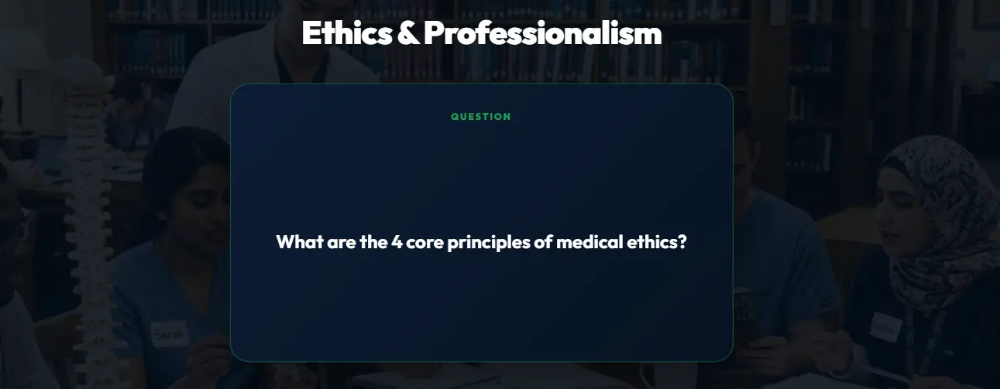
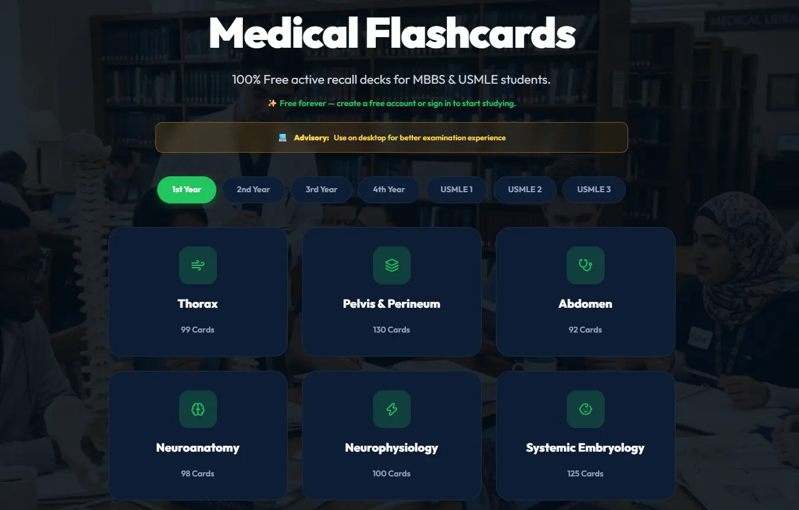

# Free USMLE Flash Cards (10,000+): The Ultimate Resource for Step 1, Step 2 CK, Step 3 & US MD Students

<strong>Key Takeaway:</strong> MediHelp has created a 100% FREE library of more than 10,000 high-yield USMLE flashcards engineered for active recall and spaced repetition across USMLE Step 1, Step 2 CK, Step 3, shelf exams, and US MD curricula. No paywalls, no subscriptions—start reviewing high-yield medical concepts instantly.

Preparing for the United States Medical Licensing Examination (USMLE) is one of the most challenging journeys in medicine. With thousands of concepts to master, hundreds of diseases to remember, and countless clinical scenarios to analyze, students need an efficient study method that improves long-term retention—not just passive reading.

That's why **MediHelp** created a **completely FREE collection of more than 10,000 USMLE flash cards** designed specifically for medical students preparing for:

* **USMLE Step 1**
* **USMLE Step 2 CK**
* **USMLE Step 3**
* **US MD Curriculum**
* **Clinical Rotations**
* **Shelf Exams**
* **International Medical Graduates (IMGs)**

No subscriptions. No hidden fees. Just high-quality flashcards built to help future physicians succeed.

<strong>10,000+</strong>high-yield medical flashcards

<strong>Steps 1, 2, 3</strong>full exam pathway coverage

<strong>12+</strong>specialty disciplines covered

<strong>100% Free</strong>no subscriptions or hidden costs

---

# Why Flash Cards Are Essential for USMLE Preparation

Medical knowledge is enormous. Reading textbooks repeatedly isn't enough. The highest-performing students rely on **active recall** and **spaced repetition**—two evidence-based learning techniques proven to dramatically improve memory retention.

Flashcards help you:

* Strengthen long-term memory
* Identify weak areas quickly
* Review thousands of concepts efficiently
* Memorize pharmacology faster
* Master microbiology organisms
* Improve diagnostic reasoning
* Prepare for clinical scenarios
* Reduce study time while increasing retention

Instead of rereading the same chapter multiple times, flashcards force your brain to retrieve information, making every study session more productive.

---

# Over 10,000 Free Medical Flash Cards

Our growing library includes more than **10,000 carefully organized flashcards** covering nearly every major discipline tested in the USMLE.

  <h3 style="margin-top:0; color:#22c55e; font-size:24px; font-weight:900; letter-spacing:-0.5px;">⚡ Ready to Test Your Knowledge?</h3>
  
Access 10,000+ free USMLE cards categorized by subject, specialty, and board exam step. 100% free with no login required.

  <a href="/flash-cards" style="display:inline-flex; align-items:center; gap:8px; background:linear-gradient(135deg, #22c55e, #10b981); color:#fff; padding:14px 28px; border-radius:12px; font-weight:900; text-decoration:none; font-size:15px; box-shadow:0 6px 20px rgba(34,197,94,0.35);">
    Start 10,000+ Free USMLE Flash Cards Now
    <svg width="18" height="18" viewBox="0 0 24 24" fill="none" stroke="currentColor" stroke-width="3"><path d="M5 12h14"/><path d="m12 5 7 7-7 7"/></svg>
  </a>

## Basic Sciences

* Anatomy
* Physiology
* Biochemistry
* Genetics
* Histology
* Embryology
* Cell Biology
* Molecular Biology

---

## Pathology

* General Pathology
* Systemic Pathology
* Disease Mechanisms
* Tumors
* Inflammation
* Immunopathology

---

## Pharmacology

Learn:

* Drug mechanisms
* Side effects
* Contraindications
* Drug interactions
* High-yield medications
* Clinical applications

---

## Microbiology

Master:

* Bacteria
* Viruses
* Fungi
* Parasites
* Antibiotics
* Laboratory diagnosis

---

## Immunology

Review:

* Hypersensitivity reactions
* Immune deficiencies
* Autoimmune diseases
* Vaccines
* Cytokines
* Immunotherapy

---

## Internal Medicine

Including:

* Cardiology
* Pulmonology
* Gastroenterology
* Endocrinology
* Nephrology
* Rheumatology
* Infectious Disease
* Hematology
* Oncology

---

## Surgery

Comprehensive flashcards covering:

* Trauma
* Acute abdomen
* Surgical emergencies
* Pre-operative care
* Post-operative care
* Burns
* Critical care
* Vascular surgery
* Orthopedics

---

## Pediatrics

Topics include:

* Neonatology
* Growth & Development
* Pediatric infections
* Congenital disorders
* Vaccinations
* Pediatric emergencies

---

## Obstetrics & Gynecology

Study:

* Pregnancy
* Labor
* High-risk pregnancy
* Gynecologic disorders
* Infertility
* Reproductive endocrinology

---

## Psychiatry

Master:

* Mood disorders
* Anxiety disorders
* Personality disorders
* Substance abuse
* Psychopharmacology
* DSM-based diagnoses

---

## Neurology

Including:

* Stroke
* Seizures
* Dementia
* Headache disorders
* Neuromuscular diseases
* Neuroanatomy

---

## Emergency Medicine

Prepare for:

* Shock
* Cardiac arrest
* Trauma
* Toxicology
* Airway management
* ACLS concepts

---

# Tailored for Every Stage of Your USMLE Journey

  

    
    
<em>Foundational science & high-yield recall for Step 1</em>

  

  

    
    
<em>Clinical diagnosis, best-next-step & treatment guidelines</em>

  

# Designed for USMLE Step 1

USMLE Step 1 emphasizes foundational sciences integrated with clinical reasoning.

Our flashcards help reinforce:

* First Aid concepts
* Pathophysiology
* Pharmacology
* Microbiology
* Biochemistry
* Anatomy
* Physiology
* Immunology

Perfect for daily review before question banks.

---

# Designed for USMLE Step 2 CK

Clinical decision-making becomes the focus during Step 2 CK.

Our cards emphasize:

* Diagnosis
* Investigations
* Best next step
* Management algorithms
* Treatment guidelines
* Emergency medicine
* Clinical reasoning

Ideal alongside clinical rotations and question banks.

---

# Designed for USMLE Step 3

Step 3 tests independent physician-level thinking.

Our flashcards cover:

* Complex management
* Hospital medicine
* Ethics
* Preventive care
* Patient safety
* Quality improvement
* Evidence-based medicine

---

# Perfect for US MD Students

Medical school never slows down.

Whether you're studying for:

* Weekly quizzes
* Block exams
* Shelf exams
* Clinical rotations
* Board preparation

our flashcards provide fast, focused review whenever you need it.

---

# High-Yield, Board-Style Questions

Each flashcard is designed to be:

* Concise
* High-yield
* Easy to remember
* Clinically relevant
* Exam focused

Instead of memorizing isolated facts, you'll build the clinical reasoning needed to answer real USMLE-style questions.

---

# Learn Anywhere

Study whenever you have a few spare minutes:

* Between lectures
* During commuting
* Coffee breaks
* Clinical rotations
* Before sleep
* While traveling

Even 15 minutes of active recall each day can significantly improve retention over time.

---

# Why Thousands of Students Prefer Free Flash Cards

Many medical students spend hundreds of dollars every year on board preparation resources.

We believe high-quality education should be accessible.

That's why our flashcard library is:

* Completely free
* Continuously updated
* Organized by specialty
* Easy to navigate
* Built for rapid review
* Suitable for beginners and advanced learners alike

Our mission is simple: help every medical student succeed, regardless of budget.

---

# Study Smarter, Not Longer

Success on the USMLE isn't about spending endless hours with textbooks.

It's about:

* Consistency
* Active recall
* Spaced repetition
* High-quality practice
* Reviewing high-yield concepts repeatedly

Our flashcards are designed around these proven learning principles, helping you retain more information in less time.

---

# Start Learning Today

Whether you're beginning your USMLE journey or reviewing during your final weeks before exam day, our **10,000+ free flashcards** are here to support your success.

Join thousands of medical students using MediHelp to strengthen their knowledge, improve retention, and prepare with confidence.

**[Start exploring our Free USMLE Flash Card Library today](/flash-cards)** and take one step closer to becoming a licensed physician.

Your next correct answer—and your next milestone—could begin with a single flashcard.

  
100% FREE USMLE RESOURCE

  <h2 style="font-size:30px; font-weight:900; margin:0 0 12px; color:#fff; border:none; padding:0;">Master the USMLE with 10,000+ Free Flash Cards</h2>
  
No registration needed. Instant access to high-yield decks across Anatomy, Pharmacology, Pathology, Step 1, Step 2 CK, & Step 3.

  <a href="/flash-cards" style="display:inline-block; background:linear-gradient(135deg, #22c55e, #10b981); color:#fff; text-decoration:none; padding:16px 36px; border-radius:14px; font-weight:900; font-size:16px; box-shadow:0 8px 24px rgba(34,197,94,0.4);">
    Launch Free USMLE Flashcards →
  </a>

---

## Frequently Asked Questions (FAQ)

### Are the flashcards really free?

Yes. Our USMLE flashcard collection is available free to help medical students learn without subscription costs.

### How many flashcards are available?

Our library contains **10,000+ flashcards**, with new content added regularly.

### Are these suitable for USMLE Step 1?

Absolutely. We cover all major Step 1 subjects including anatomy, pathology, pharmacology, microbiology, physiology, and more.

### Can Step 2 CK students use them?

Yes. We include extensive clinical flashcards focused on diagnosis, investigations, management, and patient care.

### Do the flashcards help with Step 3?

Yes. Many decks emphasize physician-level clinical decision-making, preventive medicine, ethics, and hospital management.

### Can international medical graduates (IMGs) use these flashcards?

Definitely. Our flashcards are valuable for IMGs preparing for the USMLE pathway and adapting to the US medical curriculum.

---

<!-- 🏆 Medical Exam Mastery CTA (Universal Component) -->

BEST VALUE

UPDATED: August 2026 Board Exams

<h2 style="font-size: 32px; font-weight: 900; margin: 0 0 12px; color: #fff; letter-spacing: -1px; border: none; padding: 0;">Medical Exam Mastery</h2>

Unlock the world's most affordable, high-yield Q-Bank for US MD, MBBS, and USMLE candidates.

$24.99

per year · full clinical access

<a href="https://prodat.gumroad.com/l/medical-exam-mastery" target="_blank" style="display: block; background: linear-gradient(135deg, #22c55e, #10b981); color: #fff; text-decoration: none; padding: 12px 20px; border-radius: 10px; font-weight: 900; font-size: 14px; text-align: center;">
Unlock Instant Access
</a>

---

**Keywords:** Free USMLE Flashcards, USMLE Step 1 Flashcards, USMLE Step 2 CK Flashcards, USMLE Step 3 Flashcards, US MD Flashcards, Medical Flashcards Free, Best USMLE Flash Cards, Active Recall for USMLE, Spaced Repetition Medical Students, Free Medical Study Resources, USMLE Preparation, Board Exam Flashcards.
